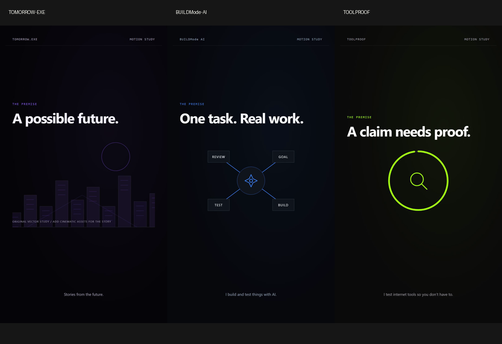

# Three-channel creation workspace

- [TOMORROW.EXE](projects/TOMORROW-EXE/README.md) — Stories from the future. Studio port 3021.
- [BUILDMode AI](projects/BUILDMode-AI/README.md) — I build and test things with AI. Studio port 3022.
- [TOOLPROOF](projects/TOOLPROOF/README.md) — I test internet tools so you don’t have to. Studio port 3023.

[Shared production instructions](studio-kit/PRODUCTION_RULES.md) · [Shared kit](studio-kit/README.md)

Each channel has 14 draft briefs, structured scenes, a complete script template, dedicated asset/output folders, a branded motion study and editable Reel compositions. Audio is deferred. Real media, experiments, factual checks and polished scripts are required before publication. No posting automation or account configuration is included.

The earlier remotion-ai-agent-reel remains separate.

Open a channel folder and run npm start. Check with npm run typecheck and npm run render:preview.

[Creation guide](studio-kit/GETTING_STARTED.md) · [Existing asset sources](studio-kit/ASSET_SOURCES.md)

## Verified previews

All three ChannelPreview exports are 12 seconds, 1080 × 1920, 30 fps, H.264. Each channel stores its preview and poster in out/. All three TypeScript checks passed; the BUILDMode draft renderer also exported a one-second sample.

